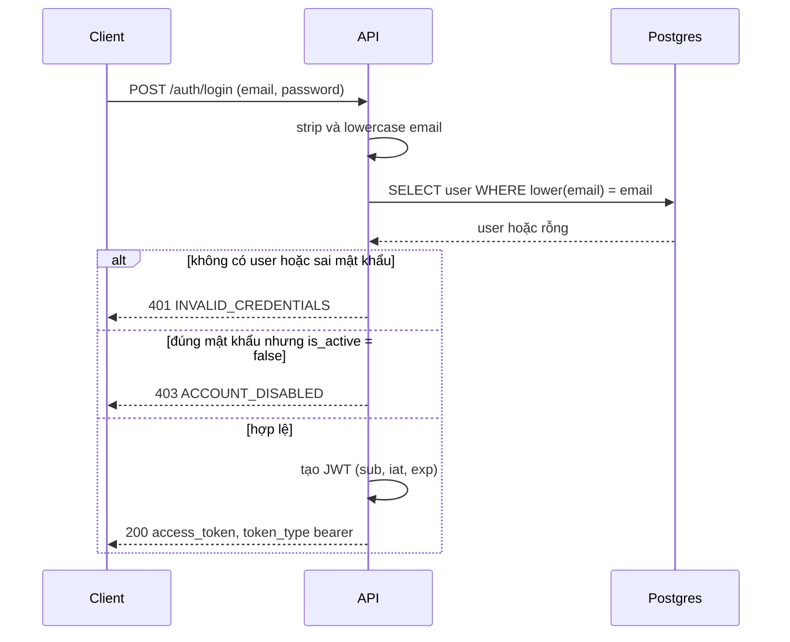
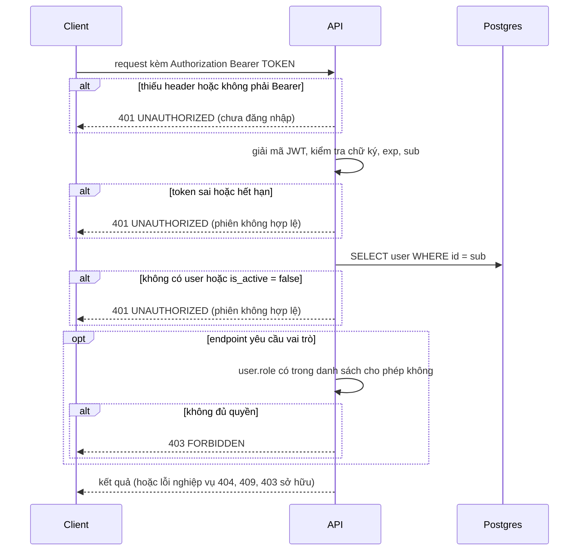

# Auth flow

Tài liệu mô tả hành vi **hiện tại** của xác thực và phân quyền. Dùng làm hợp đồng
khi chuyển module auth sang Hexagonal: sau khi chuyển, mọi mục trong tài liệu
này phải còn đúng.

## 1. Tổng quan

- Xác thực bằng JWT dạng bearer, thuật toán HS256, **stateless**.
- Token chỉ chứa `sub` (id user), `iat`, `exp`. **Không chứa role.**
- Mỗi request đều tra DB để lấy user hiện tại. Role và `is_active` luôn là giá trị
  mới nhất, nên đổi role hoặc vô hiệu hóa tài khoản có hiệu lực ngay.
- Không có refresh token. Không có cơ chế thu hồi token.
- Mật khẩu băm bằng `pwdlib` (`PasswordHash.recommended()`).

## 2. Cấu hình

| Biến môi trường | Bắt buộc | Mặc định | Ghi chú |
|---|---|---|---|
| `SECRET_KEY` | Có | không có | Thiếu thì app **không khởi động** (lỗi ngay lúc import) |
| `ACCESS_TOKEN_EXPIRE_MINUTES` | Không | `60` | Thời hạn token, tính bằng phút |
| `DATABASE_URL` | Có | không có | Postgres |
| `MONGO_URI` | Có | không có | Chỉ phục vụ articles, không liên quan auth. Mật khẩu trong URI phải mã hóa URL |

Tạo khóa ngẫu nhiên: `python -c "import secrets; print(secrets.token_urlsafe(48))"`.
Không commit `.env`. Lưu tên biến (không kèm giá trị) trong `.env.example`.

## 3. Endpoint

| Method và path | Yêu cầu | Request | Response thành công |
|---|---|---|---|
| `POST /auth/login` | Công khai | `{ email, password }` | `200 { access_token, token_type: "bearer" }` |
| `POST /auth/logout` | Token hợp lệ | không | `204` (không làm gì phía server) |
| `GET /auth/me` | Token hợp lệ | không | `200 { id, email, full_name, role, is_active }` |

Client gửi token qua header: `Authorization: Bearer <token>`.

## 4. Sơ đồ tuần tự

### 4.1 Đăng nhập

### 4.2 Gọi API cần đăng nhập

## 5. Token

| Trường | Giá trị |
|---|---|
| `sub` | id user (UUID dạng chuỗi) |
| `iat` | thời điểm cấp (UTC) |
| `exp` | `iat` + `ACCESS_TOKEN_EXPIRE_MINUTES` phút |

Không có `role` trong token, nên đổi role không cần cấp lại token.

## 6. Các nhánh lỗi

### Đăng nhập (`POST /auth/login`)

| Tình huống | Status | Code | Message |
|---|---|---|---|
| Thiếu trường hoặc email sai định dạng | 422 | không có | định dạng mặc định của FastAPI (mảng) |
| Email không tồn tại | 401 | `INVALID_CREDENTIALS` | Email hoặc mật khẩu không đúng |
| Sai mật khẩu | 401 | `INVALID_CREDENTIALS` | Email hoặc mật khẩu không đúng |
| Hash của user không hợp lệ (placeholder của user cũ) | 401 | `INVALID_CREDENTIALS` | Email hoặc mật khẩu không đúng |
| Đúng mật khẩu, tài khoản bị vô hiệu hóa | 403 | `ACCOUNT_DISABLED` | Tài khoản đã bị vô hiệu hoá |

Quy tắc: sai email và sai mật khẩu dùng **cùng một thông báo**. Kiểm tra mật khẩu
**trước**, kiểm tra `is_active` **sau**, nên không ai biết tài khoản bị khóa nếu
chưa có đúng mật khẩu. Email được `strip` và so khớp không phân biệt hoa thường.
Mật khẩu không bị `strip`.

### Gọi API có bảo vệ

| Tình huống | Status | Code | Message |
|---|---|---|---|
| Thiếu header `Authorization`, hoặc không phải Bearer | 401 | `UNAUTHORIZED` | Bạn chưa đăng nhập |
| Token sai chữ ký, hết hạn, thiếu `sub`, `sub` không phải UUID | 401 | `UNAUTHORIZED` | Phiên đăng nhập không hợp lệ hoặc đã hết hạn |
| User trong token không còn tồn tại | 401 | `UNAUTHORIZED` | Phiên đăng nhập không hợp lệ hoặc đã hết hạn |
| User trong token đã bị vô hiệu hóa | 401 | `UNAUTHORIZED` | Phiên đăng nhập không hợp lệ hoặc đã hết hạn |
| Vai trò không nằm trong danh sách cho phép | 403 | `FORBIDDEN` | Bạn không có quyền thực hiện thao tác này |

Thứ tự kiểm tra của mọi endpoint: **401, rồi 403 theo vai trò, rồi 404, rồi
403 theo quyền sở hữu** (ví dụ `PROJECT_FORBIDDEN`).

## 7. Ma trận phân quyền

Vai trò: `admin`, `manager`, `member`. "Đã đăng nhập" nghĩa là bất kỳ vai trò nào.

| Endpoint | member | manager | admin |
|---|---|---|---|
| `POST /auth/login` | công khai | công khai | công khai |
| `POST /auth/logout`, `GET /auth/me` | có | có | có |
| `GET /users`, `GET /users/{id}` | có | có | có |
| `GET /projects`, `GET /projects/{id}` | có | có | có |
| `POST /projects` | không | có | có |
| `PATCH`, `DELETE /projects/{id}` | không | chỉ project mình sở hữu | mọi project |
| Đổi `owner_id` của project | không | không | có |
| `GET /projects/{id}/members` | có | có | có |
| `GET .../members/search`, `POST`, `DELETE .../members` | không | chỉ project mình sở hữu | mọi project |
| `GET /tasks`, `GET /tasks/{id}` | có | có | có |
| `POST /tasks`, `DELETE /tasks/{id}` | không | có | có |
| `PATCH /tasks/{id}`, `PATCH /tasks/{id}/complete` | chỉ task giao cho mình, và `PATCH` chỉ được đổi `status` | có | có |
| `POST /articles`, `GET /articles`, `GET /articles/{id}` | có | có | có |

Các vai trò hợp lệ nằm ở `app/core/permissions.py`: `CAN_MANAGE = (admin, manager)`,
`ADMIN_ONLY = (admin,)`. Ràng buộc DB: `role IN ('admin','manager','member')`.

## 8. Hành vi phải giữ nguyên khi refactor

1. Mọi thông báo và code ở mục 6.
2. Cùng thông báo cho sai email và sai mật khẩu.
3. Kiểm tra mật khẩu trước, `is_active` sau.
4. Role và `is_active` đọc từ DB mỗi request, không lấy từ token.
5. Payload token gồm `sub`, `iat`, `exp`; thuật toán HS256.
6. `get_current_user` vẫn trả về đối tượng có `id`, `email`, `full_name`, `role`,
   `is_active`, vì mọi router khác đang phụ thuộc vào các thuộc tính này.
7. Thứ tự kiểm tra: 401, 403 vai trò, 404, 403 sở hữu.
8. `SECRET_KEY` thiếu thì app không khởi động.

## 9. Hạn chế đã biết (chưa xử lý, ghi để quyết định riêng)

| # | Hạn chế | Hệ quả | Hướng xử lý nếu cần |
|---|---|---|---|
| 1 | `logout` không thu hồi token | Token vẫn dùng được đến khi hết hạn | Giảm thời hạn, hoặc danh sách thu hồi |
| 2 | Không có refresh token | Hết hạn là phải đăng nhập lại | Thêm refresh token |
| 3 | Không giới hạn số lần đăng nhập sai | Dò mật khẩu hàng loạt | Rate limit theo IP và email |
| 4 | Email không tồn tại thì không băm mật khẩu | Phản hồi nhanh hơn, có thể dò email dù thông báo giống nhau | Verify với hash giả khi không có user |
| 5 | Mọi lỗi 401 xác thực dùng chung code `UNAUTHORIZED`, không có header `WWW-Authenticate` | Client không phân biệt "chưa đăng nhập" và "hết hạn" bằng code | Tách code riêng, thêm header |
| 6 | Vô hiệu hóa: login trả 403, token đang dùng trả 401 | Hai status khác nhau cho cùng một sự kiện | Thống nhất khi có quyết định |
| 7 | Lỗi 422 có định dạng khác lỗi nghiệp vụ | Client phải xử lý hai kiểu | Handler `RequestValidationError` |
| 8 | Member xem được mọi task và project; manager tạo, xóa task ở mọi project không kiểm tra sở hữu | Có thể đúng ý, cần xác nhận | Xác nhận với yêu cầu |
| 9 | Một khóa HS256 dùng chung, không xoay khóa | Đổi khóa là mọi token mất hiệu lực | Quy trình xoay khóa |

## 10. Kế hoạch chuyển sang Hexagonal

| Thành phần | Chuyển thành |
|---|---|
| `verify_password`, `hash_password` | Port `PasswordHasher`, adapter `pwdlib` |
| `create_access_token`, `decode_access_token` | Port `TokenService`, adapter `PyJWT` |
| Truy vấn user theo email và id | Port `UserAuthRepository`, adapter Postgres |
| `authenticate`, `login` | Use case `Login` |
| Phần xử lý token trong `get_current_user` | Use case `AuthenticateToken` |
| `get_current_user`, `require_role` | Giữ ở tầng HTTP, gọi use case, giữ nguyên chữ ký (mục 8, điều 6) |

Lỗi domain mới: `InvalidCredentials`, `AccountDisabled`, `NotAuthenticated`,
`InvalidSession`. Dịch sang `UnauthorizedError` và `ForbiddenError` ở
`error_translation.py` với đúng code và message ở mục 6.

## 11. Danh sách kiểm tra hành vi (Postman, chạy trước và sau refactor)

| # | Request | Kết quả mong đợi |
|---|---|---|
| 1 | Login đúng | 200, có `access_token`, `token_type` là `bearer` |
| 2 | Login sai mật khẩu | 401 `INVALID_CREDENTIALS` |
| 3 | Login email không tồn tại | 401 `INVALID_CREDENTIALS`, cùng message với #2 |
| 4 | Login với email viết hoa và thừa khoảng trắng | 200 |
| 5 | Login user bị vô hiệu hóa, đúng mật khẩu | 403 `ACCOUNT_DISABLED` |
| 6 | Login với email sai định dạng | 422 |
| 7 | `GET /auth/me` không token | 401 `UNAUTHORIZED`, "Bạn chưa đăng nhập" |
| 8 | `GET /auth/me` với token bậy | 401 `UNAUTHORIZED`, "Phiên đăng nhập không hợp lệ..." |
| 9 | `GET /auth/me` với token hợp lệ | 200, đủ `id`, `email`, `full_name`, `role`, `is_active` |
| 10 | Token hết hạn (tạm đặt `ACCESS_TOKEN_EXPIRE_MINUTES=1`, đợi 1 phút) | 401 `UNAUTHORIZED` |
| 11 | `POST /projects` bằng member | 403 `FORBIDDEN` |
| 12 | Vô hiệu hóa user rồi dùng token cũ | 401 `UNAUTHORIZED` |
| 13 | `POST /auth/logout` rồi gọi lại `GET /auth/me` bằng token cũ | 204, sau đó `/auth/me` vẫn 200 (hạn chế #1) |
